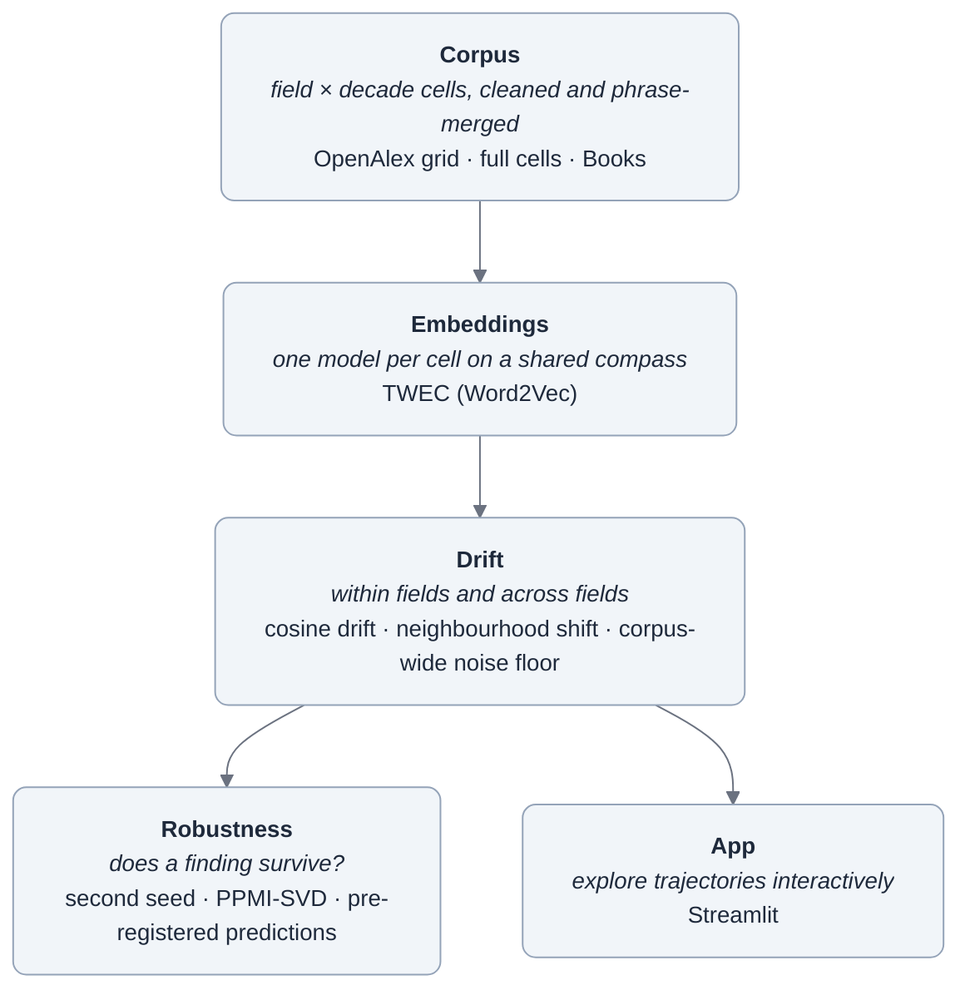

# interpretant

`interpretant` tracks how the meaning of scientific and philosophical concepts shifts across decades of academic literature. Given a word like _consciousness_ or _embodiment_, it produces a trajectory through semantic space for each field — showing which concepts surrounded it in each decade, how far it moved, and how differently fields use it. The corpus is a grid: research abstracts from eleven fields (philosophy, psychology, neuroscience, computer science, AI, HCI, linguistics, the social sciences and others), sampled the same way for every decade from the 1950s to the 2020s, plus two centuries of canonical book-length texts in philosophy of mind, AI, design, and cultural theory.

The name comes from Peirce. In Peirce's theory of signs, the _interpretant_ is neither the word nor the thing it points to — it's the meaning the sign produces in a community of minds. Not the interpreter, but the effect: the further sign, the mental response, the understanding that arises when a community encounters a representation. Peirce's key insight was that the interpretant is not fixed. It shifts as communities change, as contexts evolve, as new fields absorb old vocabularies and bend them toward new purposes. The word "intelligence" in a 1965 philosophy paper and a 2005 machine learning paper share a signifier and possibly a dynamic object, but they carry different interpretants — different networks of association, implication, and use that have accumulated around the same sign in different communities over forty years.

This project measures that drift.

---

## Motivation

Concepts migrate. "Network" meant something different to a neurologist in 1975 than to a computational biologist in 2005 or a social scientist in 2015. "Intelligence" has been borrowed, bent, and contested across philosophy, psychology, and computer science for sixty years. The word stays the same; the community using it changes what it does with the word.

Historians and philosophers of science have documented this carefully — but almost always through close reading of individual texts. The question this project asks is whether conceptual migration is _measurable at scale_: not what a handful of canonical papers say about _consciousness_, but what hundreds of thousands of abstracts across eleven fields, and two centuries of canonical texts, collectively did with it, decade by decade. And not just whether it drifted — but whether it drifted the same way across fields, and what any divergence reveals about the communities.

That question is where the method becomes an instrument for intellectual history rather than text statistics.

---

## The corpus

Every question here compares something specific — one field across decades, or several fields in the same decade — so the corpus is a grid of cells, one per field and decade, each built the same way. The design and its rationale are in [`docs/corpus.md`](docs/corpus.md).

**The OpenAlex grid** (about 677,000 abstracts): a seeded random sample of up to 10,000 English research abstracts per field and decade, 1950s–2020s, for eleven fields sharing OpenAlex's single topic taxonomy — philosophy, history and philosophy of science, linguistics, psychology, cognitive psychology, neuroscience, computer science, AI, HCI, sociology, and communication. Only research prose is kept (articles, reviews, book chapters, books, dissertations, conference papers); archive catalogue records, scraped web pages, duplicates and non-English text are removed, and no author may exceed 1% of a cell.

**Full cells**: where a word is too rare for a 10,000-abstract sample, its home field is taken in full — philosophy for the 1980s–2020s and HCI for the 2000s–2020s — for within-field trajectories.

**Books** (358 titles, 1820s–2020s, about 42 million tokens): canonical works in philosophy of mind, AI, design, and cultural theory, each dated by the English edition it contains (a translation is the translator's English) and capped at 250,000 tokens per author per decade. Every edition decision is recorded in `scripts/redate_books.py`.

PubMed, the ACL Anthology and arXiv were the original sources. The OpenAlex grid covers their fields with one taxonomy and one sampling rule, so they now stay outside the main corpus as optional layers.

---

## How it works



The original merged-corpus stages are wired into a DVC pipeline (`dvc.yaml`); the grid stages run from the CLI (see Getting started) and are not in DVC yet.

The distributional hypothesis underlying Word2Vec — "You shall know a word by the company it keeps" (Firth, 1957) — converges with Wittgenstein's observation that, for a large class of cases, meaning is use. A word vector encodes not what a word _is_ but how it _behaves_ in relation to other words across a corpus. Peirce distinguishes three registers of the interpretant:

1. **Immediate** — what a sign is interpretable as, prior to any specific context
2. **Dynamic** — the actual effect it produces on a mind at a given moment
3. **Final** — the ideal effect that would be reached at the convergent end of unlimited inquiry

A decade-trained word vector corresponds to none of these directly — but corpus statistics across a community and a period capture the aggregate of dynamic interpretant events, and that aggregate is what the pipeline measures. The vectors are social facts, not semantic facts: they capture what a community did with a sign — which words it appeared near, which arguments it enabled, which conceptual neighbours it acquired.

Models trained separately share no coordinate system. TWEC (_Training Temporal Word Embeddings with a Compass_, Di Carlo et al. 2019) solves this by training a compass first — here on the same token budget from every cell, so large recent cells do not define the space for the 1850s — and then training each cell's model with the compass's context vectors frozen. Every cell lands in one space, so a word can be compared across decades within a field and across fields within a decade. Drift is judged against the corpus itself: within each pair of cells, every word above 150 occurrences in both is ranked within its frequency bin on cosine drift and on the change of its 25 nearest neighbours, and only words in the top 5% on both count as candidates.

_Interpretant drift_ is the more precise description of what the pipeline measures. The standard framing of semantic drift is descriptive and atheoretical: the word moved. It doesn't specify what's actually changing — the word, the community, or the relationship between them. Interpretant drift treats meaning as a property of a community's relationship to signs: the community changed what it did with the sign, and the vector displacement encodes that change. "Consciousness" didn't drift. Philosophers stopped reading Husserl and started reading Crick. The word is the trace; the community is the event. The stronger claim is also why the interpretant of _intelligence_ in philosophy and the interpretant of _intelligence_ in computer science are not two measurements of the same thing — they are two different things, and separating fields in the corpus is theoretically motivated, not just methodologically conservative.

Infinite semiosis — Peirce's observation that the interpretant of a sign is itself a sign, which produces a further interpretant, indefinitely (called "unlimited semiosis" by Eco, who developed the concept at length) — offers a theoretical frame for what the pipeline makes legible: a term absorbs new associations, sheds old ones, gets borrowed by adjacent fields who use it in their own sign relations. Each decade vector is a moment in a process that has no principled end.

---

## What we expect to find

If the method is sound and the Peircean framing holds, the data should show:

- **Field-specific trajectories for shared vocabulary.** Words like _consciousness_, _representation_, and _emergence_ should show meaningfully different neighbourhoods and drift in different fields — not because the word changed, but because the communities diverged. The divergence itself is the finding.

- **Legible historical inflection points.** The shift from symbolic to statistical AI, the rise of cognitive neuroscience in the 1990s, the neural turn in NLP in the 2010s — these are well-documented events in intellectual history. They should be visible as sharp decade-level movements in the relevant vocabulary.

- **Asymmetric borrowing.** When a term migrates from one field to another — _network_ from neuroscience into computational biology, _emergence_ from complexity theory into philosophy of mind — the borrowing field's neighbourhood should show faster drift and denser assimilation of the source field's vocabulary.

- **Convergence where expected, divergence where interesting.** Some terms will have converged across fields over time as disciplines developed shared vocabulary. Others — _intelligence_, _representation_, _consciousness_ — should remain divergent or show divergence accelerating. The pattern of convergence and divergence is the intellectual history the pipeline is designed to surface.

---

## Findings

Results are tested against predictions committed to git before the evidence existed — three rounds so far, on the trained models, on a second training seed with unseen decades and field pairs, and on a second method (count-based PPMI-SVD). Every prediction and every miss is in [`docs/predictions.md`](docs/predictions.md); the story is in [devlog 04](devlogs/04.md).

**Robust across seeds and methods**

- **_Embodiment_ means two different things.** In HCI it is virtual reality's sense of body ownership and presence (neighbours: _ownership, presence, illusion, self-location, agency_); in philosophy it is phenomenological corporeality (_corporeality, intersubjectivity, temporality, spatiality, being-in-the-world_). The word is now about three times as frequent in HCI as in philosophy.
- **_Intentionality_ is stable** in philosophy from the 1980s to the 2020s.

- **Philosophy's language model came to predict HCI's abstracts better, and not the reverse.** From the 1990s to the 2020s, robust to shared abstracts, training size and five resampled runs ([cross-perplexity predictions](docs/predictions_cross_perplexity.md)). The effect is specific to HCI — philosophy's model got worse at computer science and AI abstracts over the same period — and its cause is open: neither HCI borrowing philosophy's language nor philosophy broadening into technology survived testing.

**Robust in part**

- _Representation_ in AI moves towards learned representations (_embeddings, latent, contrastive, encoder_) in every run; its symbolic 1980s (_knowledge, declarative, frame-based_) holds in TWEC only.
- HCI's _affordance_ is about experiential qualities (_physicality, qualities, interactivity_) in the 2010s in every run; the 2020s depend on the method.

**Open**

- _Information_ converging between psychology and computer science appears with TWEC, not with PPMI-SVD.
- Philosophy's 2020s _consciousness_ shifts under both methods, described as computational by one and as theories of consciousness (_IIT, global workspace_) by the other.
- Fields may be converging rather than specialising: with equal training, the mean cross-perplexity between fields fell from the 1980s to the 2010s in every run. It was observed in the data that tested the opposite prediction, so it needs its own test.
- Philosophy absorbing AI's language in the 2020s did not survive the corrected run.

---

## Getting started

```bash
# Install dependencies
uv sync

# Books: re-date the manifest and ingest (author cap of 250,000 tokens per decade)
uv run python scripts/redate_books.py
uv run interpretant corpus books ingest

# OpenAlex grid: download (needs OPENALEX_API_KEY in .env) and clean
uv run interpretant corpus openalex download
uv run interpretant corpus openalex ingest

# Merge multi-word terms (neural_network, ...), then audit coverage
uv run interpretant corpus phrases learn
uv run interpretant corpus phrases apply
uv run interpretant corpus audit --processed-dir data/phrased

# Train one TWEC model per field x decade cell, then measure drift
uv run interpretant twec grid
uv run interpretant drift grid          # data/drift/within_field.parquet, cross_field.parquet

# Robustness: a second seed and a count-based method
uv run interpretant twec grid --seed 43 --output-dir models/twec_grid_seed43
uv run interpretant ppmi grid

# Launch the dashboard (still reads the earlier merged models)
uv run interpretant app
```

To explore the interface without any corpus data, `make app-demo` runs the dashboard on synthetic vectors — useful for checking the UI before training is complete.

---

## Stack

| Tool                   | Role                                                  |
| ---------------------- | ----------------------------------------------------- |
| `uv`                   | Package management and environments                   |
| `Click`                | CLI                                                   |
| `Hydra` / `OmegaConf`  | Hierarchical configuration                            |
| `DVC`                  | Pipeline DAGs and data versioning                     |
| `gensim`               | Word2Vec training (TWEC compass and cell models)       |
| `scipy`                | PPMI-SVD (sparse SVD), legacy Procrustes alignment     |
| OpenAlex API           | Field × decade abstract samples                        |
| `scikit-learn`         | PCA for trajectory visualisation                      |
| `Streamlit` / `Plotly` | Dashboard                                             |
| `Docling` / `PyMuPDF`  | PDF extraction for books corpus                       |
| `Ruff`                 | Linting and formatting                                |
| `pytest`               | Tests (synthetic fixtures, no real NLP in test suite) |
| `mypy` (strict)        | Type checking                                         |

---

## Limitations

**Embeddings capture the interpretant, not the full Peircean triad.** There is no object in the model — no connection between the word vector and whatever the word refers to in the world. The project measures drift of the collective interpretant, not drift of reference or truth. Two words can have converging vectors because a community started using them interchangeably, or because they were genuinely tracking the same phenomenon from different angles, and the embeddings cannot distinguish between these.

**Frequency and training noise.** Rare words look volatile even when the change is noise, and retraining a cell moves an ordinary word's neighbours almost as much as a decade does (a median Jaccard distance of about 0.4 against 0.6). Drift is therefore only read through the corpus-wide noise floor (frequency bins, both measures in the top 5%), and words below 150 occurrences in a cell are not measured there.

**The corpus is not the discourse.** The grid captures research abstracts as OpenAlex classifies them; the interpretants measured here are those of academic communities, as their abstracts present them — the intended scope, but not all of discourse. OpenAlex's topic labels are noisy in small early cells, abstracts before the 1970s are often fragments, and most fields are thin before the 1980s; the 1930s–1950s rest mostly on the books.

**Decade granularity is coarse.** Training on ten-year windows smooths over within-decade shifts and may misattribute the timing of changes that happened rapidly at decade boundaries. The changepoint detection module (currently stubbed) is intended to address this.

**Equal cells trade volume for comparability.** A 10,000-abstract cell cannot measure late-arriving words such as _affordance_ or _intentionality_; full cells can, but only within their field. Cross-field comparisons also rest on few control words, and one of them (_food_) genuinely differs across fields.

---

## Roadmap

The full plan is in [`ROADMAP.md`](ROADMAP.md). Next:

- [x] Cross-perplexity between cells (first run and corrected run)
- [ ] Explain the one-sided philosophy → HCI effect (topics specific to the pair, or shared academic style)
- [ ] Held-out check per cell and a backoff rule for sparse cells
- [ ] Point the dashboard at the grid drift tables
- [ ] Sense-level drift with contextual embeddings for the open findings
- [ ] Changepoint detection for decade-level breakpoints

---

## License

MIT
