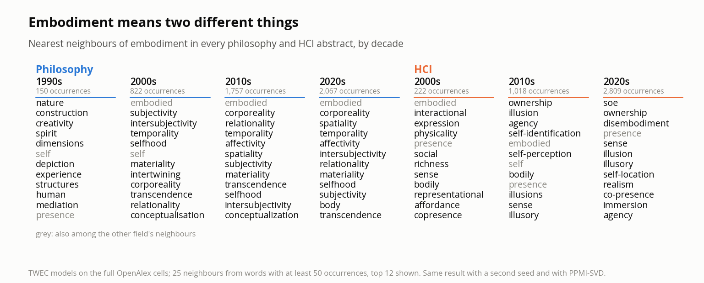
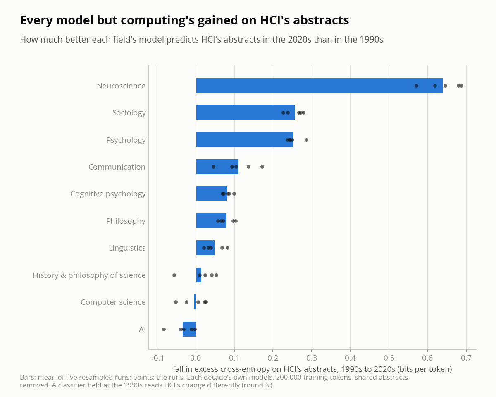
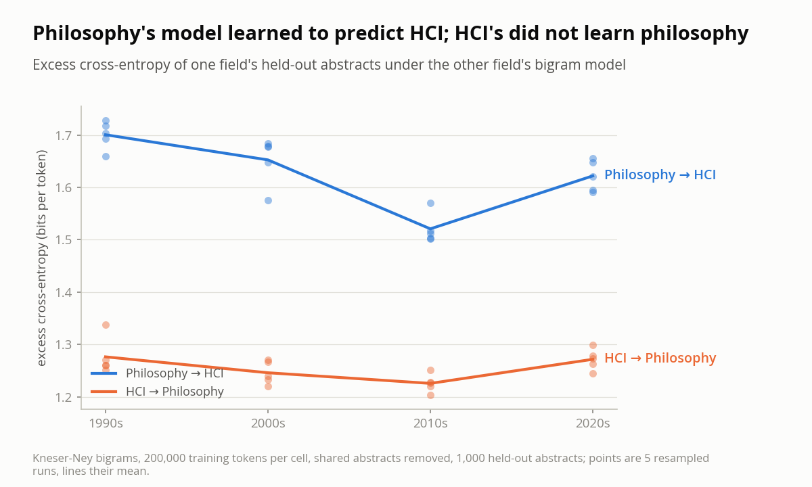
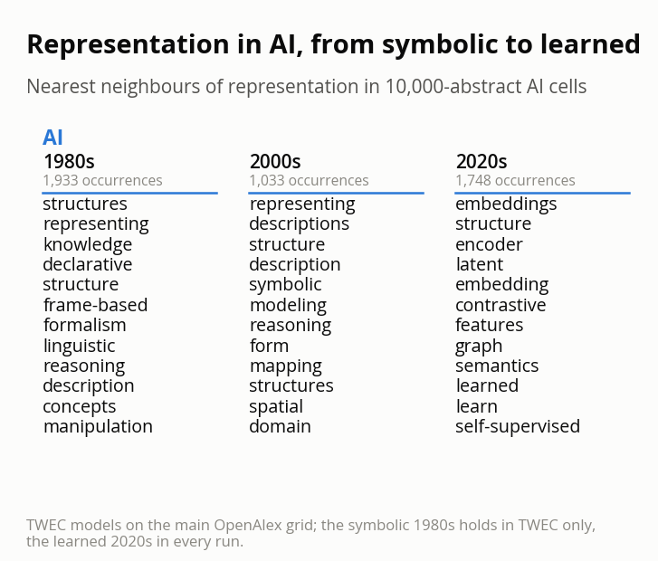
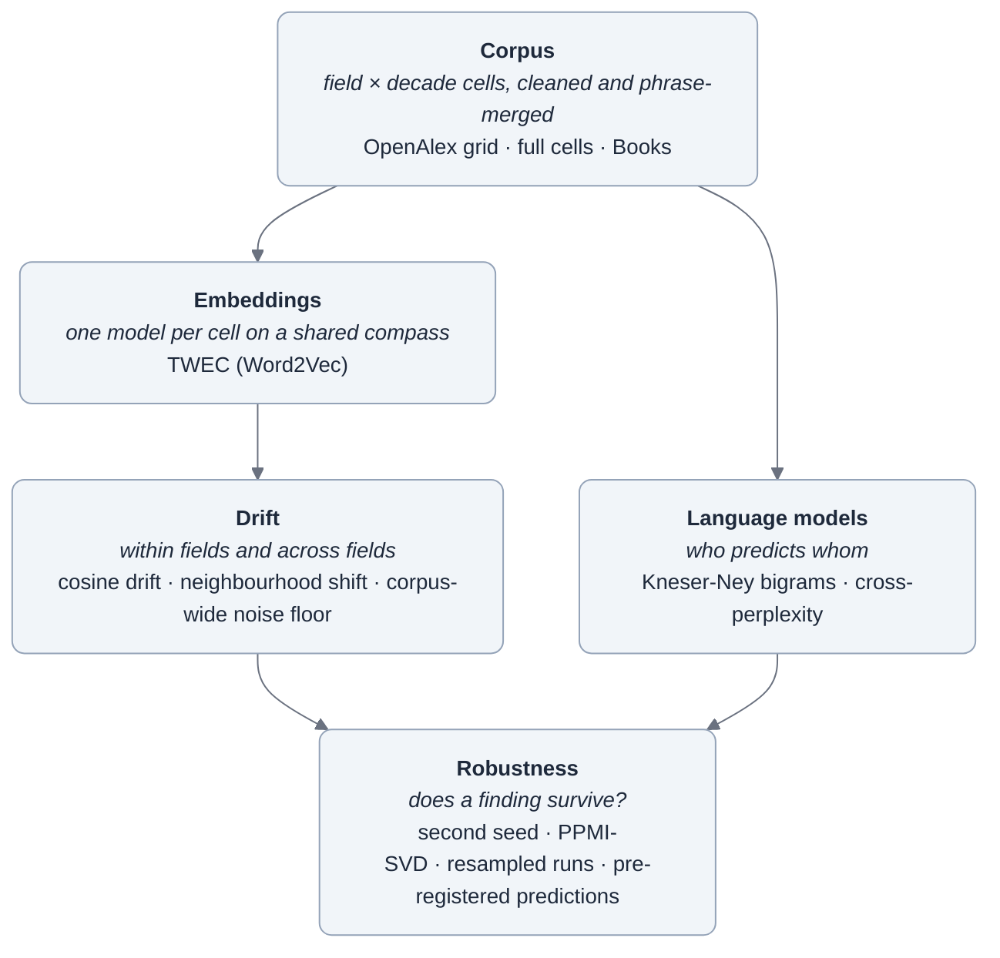
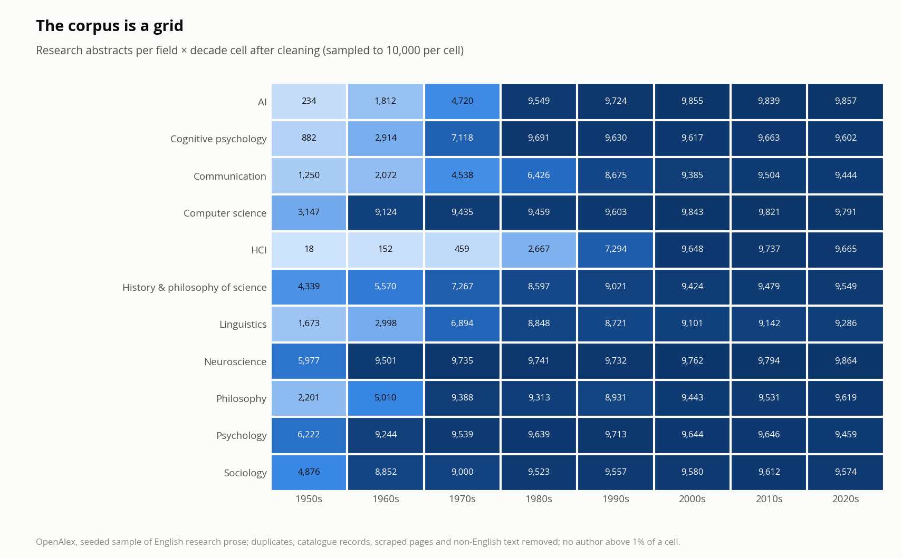

# interpretant

[](https://github.com/Dovalization/interpretant/actions/workflows/ci.yml)

`interpretant` measures how academic communities change what they do with a word. It trains one word-embedding model per field and decade on a grid of research abstracts (eleven fields, 1950s–2020s) and two centuries of canonical books, puts every model in one coordinate system, and judges each word's movement against the movement of the whole vocabulary. Every claim is tested against predictions committed to git before the evidence existed.

Two findings have survived a second training seed, a second method, a lemmatised rebuild of the corpus and pre-registered tests. **_Embodiment_ means two different things**: virtual reality's sense of body ownership in HCI, phenomenological corporeality in philosophy. And **HCI's language moved out of computing's register into the behavioural and social sciences'**: between the 1990s and the 2020s every non-computing field's language model came to predict HCI's abstracts better, computing's did not, and the change is HCI's own word mix.



---

## Findings

Results are tested against predictions committed before the evidence: four rounds on the embedding models (the trained models; a second seed with unseen decades and field pairs; a second, count-based method; the corpus rebuilt with plurals and British spellings collapsed) and six rounds on cross-perplexity. Every prediction and every miss is in [`docs/predictions.md`](docs/predictions.md) and [`docs/predictions_cross_perplexity.md`](docs/predictions_cross_perplexity.md); the story is in [devlog 04](devlogs/04.md) (the grid) and [devlog 05](devlogs/05.md) (cross-perplexity and the lemmatised corpus).

**Robust across seeds and methods**

- **_Embodiment_ means two different things.** In HCI it is virtual reality's sense of body ownership and presence (neighbours: _ownership, presence, illusion, immersion, self-location_); in philosophy it is phenomenological corporeality (_corporeality, intersubjectivity, temporality, spatiality, affectivity_). It passed every test it faced: unseen decades, a second seed, a second method, and the lemmatised corpus in both seeds. The word is now about three times as frequent in HCI as in philosophy.
- **_Intentionality_ is stable** in philosophy from the 1980s to the 2020s, under both methods and in both seeds of the lemmatised corpus.
- **HCI's language moved out of computing's register and towards the behavioural and social sciences'.** First seen as philosophy's model predicting HCI's abstracts better from the 1990s to the 2020s (robust to shared abstracts, training size, five resampled runs and the lemmatised corpus), it turned out to be general: psychology's, sociology's, neuroscience's, cognitive psychology's, communication's and linguistics' models all gained on HCI in every seed, by more than they gained on other texts, while AI's and computer science's did not. The gain is a change in HCI's own word mix (its 1990s GUI-engineering vocabulary, _menu, display, graphical, user_interface, software_, giving way to _research, study, participant, experience_), spread across its abstracts, and one-sided: nobody's language moved towards HCI. Three explanations were tested and failed on the way (HCI borrowing philosophy's words; philosophy turning to technology; philosophy learning HCI's objects).
- **Fields converged between the 1980s and the 2010s**, and **a subfield's model predicts its parent field better than the reverse** (AI → computer science, cognitive psychology → psychology): both first seen as reversed predictions, then predicted and confirmed on the lemmatised corpus.





**Robust in part**

- _Representation_ in AI moves towards learned representations (_embedding, latent, encoder, learned_) in every run including the lemmatised one; its symbolic 1980s (_knowledge, reasoning, declarative_) holds in TWEC only.
- HCI's _affordance_ is about experiential qualities (_physicality, experiential, interactivity, materiality_) in the 2010s in every run; the 2020s depend on the method.
- Philosophy's 2020s _consciousness_ moves (a candidate under TWEC in both corpora); the lemmatised neighbours carry both earlier readings at once, computational vocabulary (_computational, substrate, information_processing_) and theories of consciousness (_qualia, sentience_).



**Open**

- _Information_ converging between psychology and computer science: seen in both unlemmatised TWEC seeds, absent in PPMI-SVD, and under the committed threshold on the lemmatised corpus. Not robust.
- The share of HCI abstracts using philosophy's theme words (_experience, value, meaning, agency, embodied_) doubled from the 1990s to the 2020s; observed in round G, not predicted.

My guesses before each round were worse than the method. Round 1 passed 3 of 9 predictions; the misses, stated as predictions, passed on unseen evidence in round 2 (7 of 9); round 4, on the lemmatised corpus, passed 9 of 11, and one of its misses was a wrong guess about the instrument itself (neighbour pools shrank when frequent plurals merged, instead of growing). The predictions files record every miss and every correction of an interpretation.

---

## How it is tested



**One model per cell, one space.** Models trained separately share no coordinate system. TWEC (_Training Temporal Word Embeddings with a Compass_, Di Carlo et al. 2019) trains a compass first, here on the same token budget from every cell so that large recent cells do not define the space for the 1850s, and then trains each cell's model with the compass's context vectors frozen. Every cell lands in one space, so a word can be compared across decades within a field and across fields within a decade.

**Drift is judged against the corpus itself.** Retraining a cell moves an ordinary word's neighbours almost as much as a decade does, so a raw distance means little. Within each pair of cells, every word above 150 occurrences in both is ranked within its frequency bin on cosine drift and on the change of its 25 nearest neighbours; only words in the top 5% on both count as candidates. Everyday control words check the floor; they are flagged in under 1% of measurements.

**Who predicts whom.** A Kneser-Ney bigram model per cell scores every other cell's held-out abstracts. The excess cross-entropy of field B's text under field A's model, over B's own model, measures how predictable B's language is from A's (Vilhena et al. 2014). Parent and subfield cells share no abstracts, every model trains on the same number of tokens, and each run is repeated with five seeds.

**Nothing counts once.** A candidate becomes a finding only if it survives a second training seed, a count-based PPMI-SVD model with the settings of Levy, Goldberg and Dagan (2015), and a prediction written and committed before the evidence was looked at.

---

## The corpus

Every question here compares something specific, one field across decades or several fields in the same decade, so the corpus is a grid of cells, one per field and decade, each built the same way. The design and its rationale are in [`docs/corpus.md`](docs/corpus.md).



Regular plurals and British spellings are collapsed before training (`corpus lemmas`); verbs, participles and _-ing_ nominalisations are left alone, because a general lemmatiser turns _learning_ into _learn_. The unlemmatised grid remains on disk as the frozen evidence for rounds 1–3.

**The OpenAlex grid** (about 677,000 abstracts): a seeded random sample of up to 10,000 English research abstracts per field and decade, 1950s–2020s, for eleven fields sharing OpenAlex's single topic taxonomy. Only research prose is kept (articles, reviews, book chapters, books, dissertations, conference papers); archive catalogue records, scraped web pages, duplicates and non-English text are removed, and no author may exceed 1% of a cell.

**Full cells**: where a word is too rare for a 10,000-abstract sample, its home field is taken in full, philosophy for the 1980s–2020s and HCI for the 2000s–2020s, for within-field trajectories.

**Books** (358 titles, 1820s–2020s, about 42 million tokens): canonical works in philosophy of mind, AI, design and cultural theory, each dated by the English edition it contains (a translation is the translator's English) and capped at 250,000 tokens per author per decade. Every edition decision is recorded in `scripts/redate_books.py`.

---

## Why "interpretant"

In Peirce's theory of signs, the _interpretant_ is neither the word nor the thing it points to; it is the meaning the sign produces in a community of minds, and it is not fixed. The word "intelligence" in a 1965 philosophy paper and a 2005 machine learning paper share a signifier and possibly an object, but they carry different interpretants: different networks of association, implication and use that have accumulated around the same sign in different communities.

Word vectors are a natural instrument for this. The distributional hypothesis behind Word2Vec, "you shall know a word by the company it keeps" (Firth, 1957), converges with Wittgenstein's observation that, for a large class of cases, meaning is use: a vector encodes not what a word _is_ but how a community used it. So the pipeline does not measure a word drifting. It measures a community changing what it does with a sign, which is why philosophy's _intelligence_ and computer science's _intelligence_ are treated as two things, and why the corpus is split by field. The longer account, with Peirce's three registers of the interpretant and infinite semiosis, is in [`docs/methods.md`](docs/methods.md).

---

## Explorer

`web/` is a static Next.js explorer of the same data: a word's neighbour columns per field and
decade, its drift ranks and frequency, the cross-field divergence matrix, the who-predicts-whom
matrix with each pair over time, and the full prediction ledger. It reads JSON exported from the
models and tables (`uv run python -m interpretant.export web/data`), so it needs no Python to
build:

```bash
cd web && pnpm install && pnpm dev
```

## Getting started

```bash
# Install dependencies
uv sync

# Books: re-date the manifest and ingest (author cap of 250,000 tokens per decade)
uv run python scripts/redate_books.py
uv run interpretant corpus books ingest

# OpenAlex grid: download (needs OPENALEX_API_KEY in .env) and clean
uv run interpretant corpus openalex download
uv run interpretant corpus openalex ingest

# Collapse plurals and British spellings, merge multi-word terms, then audit coverage
uv run interpretant corpus lemmas learn      # writes data/processed/lemmas.tsv for review
uv run interpretant corpus lemmas apply
uv run interpretant corpus phrases learn
uv run interpretant corpus phrases apply
uv run interpretant corpus audit --processed-dir data/phrased --output data/phrased/audit.json

# Train one TWEC model per field x decade cell, then measure drift
uv run interpretant twec grid
uv run interpretant drift grid          # data/drift/within_field.parquet, cross_field.parquet

# Robustness: a second seed and a count-based method
uv run interpretant twec grid --seed 43 --output-dir models/twec_grid_seed43
uv run interpretant ppmi grid

# Cross-perplexity between fields (corrected design, five seeds)
uv run interpretant drift perplexity --drop-shared --fixed-budget 200000 \
  --seed 1 --seed 2 --seed 3 --seed 4 --seed 5 \
  --output data/drift/cross_perplexity_corrected.parquet

# Redraw the figures above
uv run interpretant figures

# Score the predictions against the evidence
uv run python scripts/score_predictions.py
```

---

## Stack

| Tool                   | Role                                                  |
| ---------------------- | ----------------------------------------------------- |
| `uv`                   | Package management and environments                   |
| `Click`                | CLI                                                   |
| `gensim`               | Word2Vec training (TWEC compass and cell models), phrase detection |
| `scipy`                | PPMI-SVD (sparse SVD)                                 |
| OpenAlex API           | Field × decade abstract samples                        |
| `pandas` / `pyarrow`   | Drift and cross-perplexity tables                     |
| `matplotlib`           | Figures                                               |
| `Streamlit` / `Plotly` | Dashboard                                             |
| `Docling` / `PyMuPDF`  | PDF extraction for the books corpus                   |
| `Ruff`, `mypy` (strict), `pytest` | Linting, type checking, tests (synthetic fixtures, no real NLP in the suite) |

---

## Limitations

**Embeddings capture the interpretant, not the full Peircean triad.** There is no object in the model, no connection between the word vector and whatever the word refers to in the world. The project measures drift of the collective interpretant, not drift of reference or truth. Two words can have converging vectors because a community started using them interchangeably, or because they were genuinely tracking the same phenomenon from different angles, and the embeddings cannot distinguish between these.

**Frequency and training noise.** Rare words look volatile even when the change is noise, and retraining a cell moves an ordinary word's neighbours almost as much as a decade does (a median Jaccard distance of about 0.4 against 0.6). Drift is therefore only read through the corpus-wide noise floor, and words below 150 occurrences in a cell are not measured there.

**The corpus is not the discourse.** The grid captures research abstracts as OpenAlex classifies them; the interpretants measured here are those of academic communities, as their abstracts present them. OpenAlex's topic labels are noisy in small early cells, abstracts before the 1970s are often fragments, and most fields are thin before the 1980s; the 1930s–1950s rest mostly on the books.

**Decade granularity is coarse.** Training on ten-year windows smooths over within-decade shifts and may misattribute the timing of changes that happened rapidly at decade boundaries.

**Equal cells trade volume for comparability.** A 10,000-abstract cell cannot measure late-arriving words such as _affordance_ or _intentionality_; full cells can, but only within their field. Cross-field comparisons also rest on few control words, and one of them (_food_) genuinely differs across fields.

---

## Roadmap

The plan is in [`ROADMAP.md`](ROADMAP.md). Next: explain the one-sided philosophy → HCI effect, test the convergence of fields, point the dashboard at the grid tables, and sense-level drift with contextual embeddings for the open findings.

---

## License

MIT
