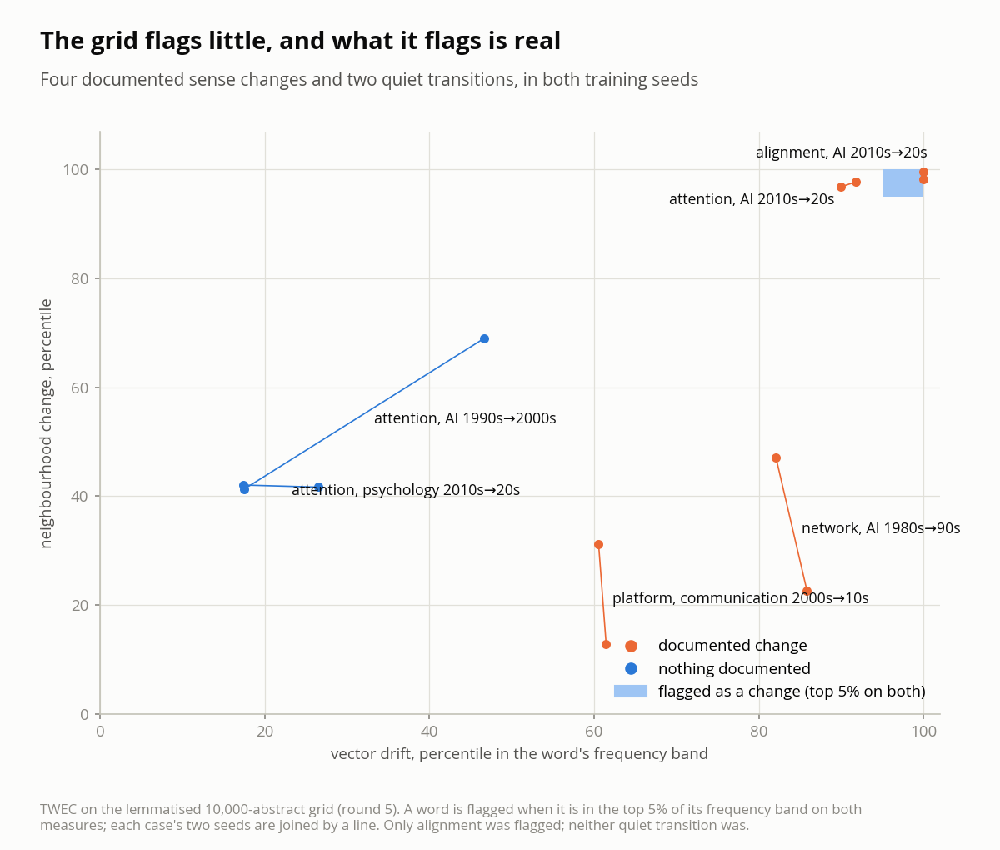
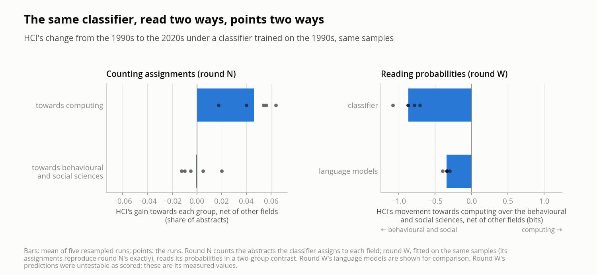

# Calibrate before you measure

*Five instruments against known answers in a pre-registered study of meaning across fields.*

*Draft. Every number below is from `docs/predictions.md`, `docs/predictions_cross_perplexity.md`,
`docs/predictions_senses.md`, `docs/predictions_pairs.md`, `docs/predictions_labels.md` or
`docs/diagnostics.md`, where the predictions, checks, scorers and verdicts are recorded.*

---

## 1. The study in brief

`interpretant` asks how academic communities change what they do with a word. The name is
Peirce's: the interpretant is the meaning a sign produces in a community of interpreters, and it
is not fixed. The project measures it in research abstracts, by field and decade.

**The corpus.** About 677,000 English research abstracts from OpenAlex, a seeded sample of up to
10,000 per field and decade for eleven fields (philosophy, history and philosophy of science,
linguistics, psychology, cognitive psychology, neuroscience, computer science, AI, HCI,
sociology, communication), 1950s–2020s; whole-field cells for philosophy and HCI where a word is
too rare for a sample; and, until 2026-11-11, 358 canonical books, 1820s–2020s. Catalogue records, scraped pages,
duplicates and non-English text are removed, and no author may exceed 1% of a cell. Plurals and
British spellings were later collapsed and every model rebuilt.

**The protocol.** Predictions are committed to git before the evidence they concern exists or is
inspected. A scorer is committed next, then run; its verdicts are appended under the predictions,
which are never edited. A falsified prediction stays falsified, a corrected interpretation goes
in a new section, and a scorer is frozen once it has run. Exploratory readings made after a
result are labelled as such and count for nothing until a later round predicts them.

**The ledger.** Thirty-one rounds and two diagnostic checks have been scored, with 183 verdicts:
91 passed, 84 falsified and 8 untestable as written. The appendix lists every round. Roughly
half the predictions failing is not a sign of a broken method; most of them were bets on open
questions, and several misses, restated as predictions, passed on unseen evidence in the next
round.

## 2. Five instruments

**The embedding grid.** One word2vec model per field and decade, trained with TWEC (Di Carlo et
al. 2019): a compass trained first on an equal token budget from every cell, then each cell's
model trained with the compass's context vectors frozen, so every model lands in one space. A
word's movement between two cells is judged against the movement of the whole vocabulary: within
each pair, every word with at least 150 occurrences in both cells is ranked within its frequency
band on cosine drift and on the change of its 25 nearest neighbours, and only words in the top 5%
on both are *candidates*. A second training seed and a count-based PPMI-SVD model (Levy, Goldberg
and Dagan 2015) test whatever the first seed finds. Questions: does a word change meaning within
a field, and do two fields use it differently?

**The field-level measures.** A Kneser-Ney bigram model per field and decade, scored on every
other field's held-out abstracts: the *excess cross-entropy* E(A → B), the bits per token B's text
costs under A's model over its own, measures how predictable B's language is from A's (Vilhena et
al. 2014). Later rounds added a TF-IDF and logistic-regression classifier that assigns abstracts
to fields. Questions: which fields' languages grew closer, and which way did HCI's move?

**The sense instrument.** Each occurrence of a word is encoded in its sentence by a contextual
model (SciBERT, and ModernBERT for comparison), all fields' and decades' occurrences are
clustered together, and each cell's share of each sense is read (Giulianelli et al. 2020).
Question: how is a word's meaning divided among its senses in each field, and how does that
change?

**The usage-pair instrument.** Each occurrence of a word is encoded in its sentence by XL-LEXEME,
with the target marked, and two cells are compared by the cosine distances between their usages:
APD, the mean distance over every pair of one usage from each cell, and J, APD minus the mean
distance within each cell, which nets out how varied a word's usages are (Kutuzov et al. 2022).
Question: did a word's meaning change between two cells?

**The sense-label instrument.** Each occurrence of a word is given one sense from a short list
written for that word in advance, and a cell's meaning is its share of each sense; a change is the
Jensen-Shannon divergence between two cells' shares. The labellers were two language models
(Claude Sonnet 5.5 and JEV) and, from round E, a logistic-regression classifier on XL-LEXEME
vectors, trained on usages whose cue words name one sense, with no generative model in the
pipeline. Question: how is a word's use divided among listed senses, and how does that change?

## 3. Checks that were not enough

Each instrument was checked against itself, carefully.

- **Controls.** Everyday words matched to the targets' frequencies should not drift above the
  noise floor. They were flagged in 0.3% to 0.9% of their measurements, round after round.
- **Retraining noise.** Retraining a cell changes an ordinary word's 25 neighbours by a median
  Jaccard distance of about 0.4, against about 0.6 between consecutive decades, so raw
  neighbourhood change is mostly noise. Every flagged change cleared it: 54 of 54 within fields,
  473 of 473 across fields.
- **A second method and a rebuilt corpus.** TWEC and PPMI-SVD neighbour lists overlap (median
  Jaccard 0.32), and findings were retested on a lemmatised rebuild in two seeds.
- **Memorisation.** A held-out check measured how much worse each cell's language model does on
  text it never saw; no cell behind a robust finding is flagged.
- **Separation.** Every field's own language model gives its held-out text the lowest
  cross-entropy, in every cell and seed; the classifier tells every pair of fields apart.
- **Agreement between encoders.** SciBERT and ModernBERT chose the same senses and the same
  shares to within a few hundredths.

These checks establish reliability: an instrument that gives the same answer twice, does not
memorise its training text, and does not flag ordinary words. They do not establish validity,
whether it detects the change it is used to detect. The predictions could have done that, but
most of them were bets on open questions, and a failed bet on an open question cannot say
whether the hypothesis was wrong or the instrument blind. P2 is the clearest case: the grid did
not flag *network* at AI's connectionist turn, and the miss was read as a fact about *network*.
Only predictions about changes whose history is known separate the two.

## 4. What known answers revealed

Each of the project's instruments passed the checks that compare an instrument with itself.
The embedding grid flagged under 1% of control words and separated every flagged change from
retraining noise; the language models scored every field's text best under its own model; the
two contextual encoders agreed with each other to within a few hundredths. None of those checks
asks whether the instrument finds a change that is known to have happened. When that question
was finally asked, each instrument answered it differently. The last two instruments were built
after that lesson and were given known answers before any open question.

### 4.1 The embedding grid is cautious

The grid trains one embedding model per field and decade, aligns them, and flags a word as a
*candidate* when it is in the top 5% of its frequency band on two measures at once: how far its
vector moved and how much its 25 nearest neighbours changed. Round 5 gave it four sense changes
with a documented date and field, and two transitions where nothing documented happened.

| Known change | Cosine rank, neighbour rank (seed 42; seed 43) | Flagged |
|---|---|---|
| *alignment* in AI, 2010s → 2020s (aligning language models, 2022) | 100, 100; 100, 98 | yes |
| *attention* in AI, 2010s → 2020s (the attention mechanism, 2014–2017) | 92, 98; 90, 97 | no |
| *network* in AI, 1980s → 1990s (neural networks after 1986) | 86, 23; 82, 47 | no |
| *platform* in communication, 2000s → 2010s (digital platforms) | 61, 13; 61, 31 | no |
| *attention* in AI, 1990s → 2000s (nothing documented) | 17, 41; 47, 69 | no |
| *attention* in psychology, 2010s → 2020s (nothing documented) | 17, 42; 27, 42 | no |

The grid flagged one documented change in four, and that one was the case judged weakest
before the run, because the 2020s also use *alignment* for cross-modal alignment. It flagged
neither quiet transition. Across fields, *attention*'s rank between AI and psychology, cognitive
psychology and neuroscience rose from the 1990s to the 2020s in all six comparisons, to between
29 and 75; the prediction asked for at least 90.

The pattern is a cautious instrument, not a noisy one. A word it flags has very likely changed:
control words have stayed quiet in every round (0.3% to 0.9% of their measurements flagged), and
so did both quiet transitions here. A word it does not flag may have changed anyway. *attention*'s
neighbours changed more than those of 97–98% of words of its frequency, but its vector drift
ranked 90–92 and the double threshold excluded it. Two misses may come from the cells themselves:
communication's 2000s cell may already hold the digital-platform sense, and AI's 1980s cell spans
the revival of neural networks in 1986, so a change can fall inside a decade instead of between
two. Those explanations came after the results and are untested.

The consequence for the findings runs in one direction. *Embodiment*'s two senses rest on
neighbour lists that matched word sets fixed in advance, in two seeds and two methods; a
cautious instrument makes a positive finding more credible, not less. *Intentionality* had been
reported as stable in philosophy because no transition from the 1980s to the 2020s was flagged,
in four rounds. That is a null result, and a null from an instrument that misses three of four
documented changes is not evidence of stability. It is now reported as no change detected.

The miss was in the record from the start. Round 1 predicted that *network* in AI would be
flagged at the connectionist or the deep-learning turn (P2). It was not, at either (cosine and
neighbour ranks 84 and 90 for the 1980s → 1990s, 79 and 54 for the 2000s → 2010s), and the
miss was filed as a wrong prediction about *network*, not as information about the instrument.
Four rounds then tested findings on the same grid before anyone asked what it could detect.

### 4.2 The field-level measures had no known answer

The second family of instruments compares whole fields: a bigram language model per field and
decade, scored on other fields' abstracts (cross-perplexity), and a classifier that assigns
abstracts to fields. They were used to ask which way HCI's language moved between the 1990s and
the 2020s. Nothing outside the corpus answers that question, so no prediction could check the
instruments against the world, only against each other. Over thirteen rounds, each failure
exposed something a change in the measure could mean other than the change it was read as.

- **Shared documents.** OpenAlex files AI under computer science and cognitive psychology under
  psychology, so 18–29% of AI's abstracts were also in computer science's cell. A parent's model
  could train on its subfield's held-out text, which produced negative excess values and favoured
  the parent in every comparison. With shared abstracts removed, the predicted asymmetry
  reversed: a subfield's model predicts its parent better than the reverse, in every decade.
- **Training size.** The first run trained the 1980s models on 205,731 tokens and the 2010s
  models on 1,000,000, and found fields growing more specialised. With one training size, the
  same comparison came out the other way in every seed (−0.040 to −0.061 bits): fields
  converged.
- **Predictable is not borrowed.** Philosophy's model came to predict HCI's abstracts better, in
  every seed (falls of 0.056–0.103 bits), and HCI's model did not come to predict philosophy's.
  It read as HCI borrowing philosophy's language. But the excess E(A → B) falls when B moves
  towards A *or* when A broadens to cover B, and none of twelve philosophical words was among the
  fifty whose excess fell most; the list was led by *the, user, design, system, interface*.
  Splitting the fall into a change in HCI's word mix and a change in philosophy's per-word skill
  put most of it in the mix (0.039–0.091 bits per seed, against a skill effect from −0.029 to
  +0.039). HCI had shed its 1990s interface jargon, which philosophy's model found most alien.
- **A label that widens.** OpenAlex's HCI cell spans 915 sources in the 1990s and 3,601 in the
  2020s; the venues HCI had in both decades fell from a fifth of the cell to under a tenth. A
  whole-cell measurement mixed the field's change with the label's. A venue-stable cell
  separated them: inside fixed venues, psychology's model gained half as much on HCI as on the
  whole cell, and sociology's gained more.
- **Everyone drifts.** A classifier trained on the 1990s sends every field's 2020s abstracts away
  from home more often, and some fields receive more of those departures than others. A field's
  raw gain towards another mostly measured that.
- **Counting against reading.** Round N netted out the general drift by subtracting other fields'
  median gain towards a target, and found HCI moving towards computing (+0.046, sd 0.018) and not
  towards the behavioural and social sciences. A synthetic calibration run afterwards showed the
  measure reporting such moves for a field that only changes more than the rest. Round W then
  fitted the same classifier on the same samples, reproducing round N's assignments exactly, and
  read its probabilities instead of its labels. HCI's movement came out towards the behavioural
  and social sciences, and strongly (−0.867 towards computing, sd 0.139), in agreement with the
  language models (+0.343 towards the behavioural and social sciences, sd 0.035).

Synthetic calibration helped and did not settle it. Round W's predictions were guarded by a
planted check: replace 10% of HCI's abstracts with another field's and see whether each
instrument notices. On synthetic fields, the two halves of one decade varied between seeds with a
standard deviation of 0.04 (classifier) and 0.01 (language models); on real abstracts, 0.15 and
0.06. The check, which compared each planted run with zero rather than with its own seed's
unplanted halves, failed for both instruments, and the round was untestable as scored. Compared
seed by seed with the unplanted halves, both instruments found both plants (+0.24 and +0.39 for
the classifier, +0.08 and +0.15 for the language models). A synthetic world calibrated the method
and misjudged the noise.

Every item above was a real lesson, and each was found by a prediction that failed. None of them
produced a claim about the fields that survived the next round. Without a known answer, the
instruments could only be tested against each other, and the rounds ended up measuring the
instruments.

### 4.3 The sense instrument found the senses and could not count them

The third instrument encodes each occurrence of a word in its sentence with a contextual model,
clusters all fields' and decades' occurrences together, and reads each cell's share of each
sense. Unlike the field-level question, sense change has known answers, so this instrument was
calibrated on them before any open question, in three rounds.

| Round | Known answer | What happened |
|---|---|---|
| C | *attention*'s mechanism sense in AI; AI's *intelligence* entering other fields | The silhouette chose two senses, joining the attention mechanism with cognitive attention: that sense already held 0.14–0.15 of AI's 1990s uses and a third of psychology's. AI's change still exceeded all 30 random control words', and AI's *intelligence* rose in all four fields |
| C′ | *hallucination*'s language-model sense, unseen | With eight senses, *attention*'s mechanism separated cleanly (0.005–0.048 of AI's 1990s uses, 0.55–0.61 of its 2020s ones). The language-model senses held 0.81–0.88 of AI's 2020s uses, but in two seeds the rule that grouped senses into a meaning took a mixed sense as well, with 0.12–0.21 of psychology's 2000s uses |
| C″ | *prompt*'s language-model sense, unseen | A repaired grouping rule failed both ways: too narrow in three seeds (0.09–0.30 of AI's 2020s uses), too broad in two (0.19 and 0.39 of AI's 2000s uses) |

The encoder placed every known change where its history puts it, in every round; the examples
were always readable (*prompt engineering, retrieval-augmented generation, zero-shot*). What never
held on a case it had not been chosen on was the step from clusters to one meaning's share. Each
version of that step leaned on marker phrases chosen by hand to identify the meaning, and in round
C″ the result depended on them: *prompt engineering*, one of the markers, formed a sense so pure
that the threshold it set excluded the other language-model senses. The instrument was partly
supervised without saying so. A rule committed before round C″ stopped the work there.

### 4.4 The usage-pair instrument measured contexts

The fourth instrument was calibrated in the order the grid was not: a published benchmark first,
then this project's known changes, then open questions, each rung pre-registered with a rule for
stopping. It compares usages directly. XL-LEXEME encodes each occurrence of a word with the target
marked; APD is the mean distance between a usage from one cell and a usage from the other, and J
subtracts from it the mean distance within each cell.

Rung 1, round U, used DWUG EN: about 9,000 English usages of 46 words from two periods, with a
graded change score per word from human judgements of usage pairs (Schlechtweg et al. 2021). APD
agreed with that score at 0.864 (Spearman), against 0.886 published (Periti and Tahmasebi 2024),
so the pipeline was reproduced. A control showed what the agreement was made of. With every
word's usages shuffled between the two periods, so that no difference between periods could be
measured, APD still agreed at 0.842: words with more senses also have higher change scores, and
APD ranks words by how varied their usages are. J fell to noise under the shuffle (mean −0.124)
and agreed with the real score at 0.539, under its bar of 0.75.

Rung 2, round X, gave the frozen configuration round 5's documented changes and quiet
transitions, with *prompt* in AI, 2000s → 2020s, added. A measure found a change when it beat both
the 95th percentile of 200 shuffles of the word's usages between the two cells, which rules out
variety alone, and the 90th percentile of the transition's control words, which rules out the
drift every word shows between decades.

| Case | APD | J |
|---|---|---|
| *attention* in AI, 2010s → 2020s | not found | found |
| *prompt* in AI, 2000s → 2020s | found | found |
| *platform* in communication, 2000s → 2010s | not found | found |
| *network* in AI, 1980s → 1990s | not found | found |
| *alignment* in AI, 2010s → 2020s (weak case) | not found | found |
| *attention* in AI, 1990s → 2000s (nothing documented) | not found | found |
| *attention* in psychology, 2010s → 2020s (nothing documented) | not found | not found |

APD found one documented change in four, because the controls' APD measures how varied each word
is. J found all four and the weak case, including *network* and *platform*, which every earlier
instrument had missed. It also found the quiet transition of *attention* in AI, narrowly (0.0019
against bars of 0.0014 and 0.0015) and on the smallest cells in the round, about 180 usages each.
The reading rule asked one measure both to find the documented changes and to stay quiet on both
quiet transitions. Neither did both, and the instrument stopped at this rung, as the rule
required.

Four diagnostic checks then asked where the problem lay, each committed before anything it
counted was looked at.

- **Are the changes in the cells?** Check 1a counted marker phrases for each documented sense in
  round X's usages and read 20 usages per cell blind to cell and case (the reading done by Claude,
  open to the author's correction). All five documented changes were present and both quiet
  transitions quiet. A change an instrument misses on these cells is the instrument's miss, not
  the data's, and that includes round 5's grid, whose cells are the same samples. Read from the
  table, not predicted: about two thirds of the 1980s *network* uses and of the 2000s *platform*
  uses were already the later sense, so the decade cells catch the end of those changes; and only
  about one in seven of *alignment*'s 2020s uses is about aligning AI systems, so the grid's one
  hit is unlikely to be the documented change.
- **How large a change can it see?** Check 1b replaced a share of psychology's 2020s *attention*
  usages, a quiet cell, with AI's 2020s usages that carry attention-mechanism markers. J found the
  plant in none of five draws at 10% and 20%, and in all five at 30%, 40% and 60%. A placebo, 40%
  of AI's usages without the markers, was meant to change the usages' source and not their sense;
  J found it in all five draws. A correction recorded later showed the placebo was not clean: AI's
  unmarked uses of *attention* are mostly notice or consideration, computational selection and
  unmarked mechanism uses, not the cognitive attention they replaced, so it moved the cell's mix
  of senses too. The verdict stands; check 1b does not on its own show a response to source with
  the sense held fixed.
- **Does it read abstracts as a person does?** Check 2b compared XL-LEXEME's similarity for 96
  pairs of usages with the author's judgements on the DURel scale: Spearman 0.431, under the bar
  of 0.5. By word it was 0.70 for *attention* and 0.66 for *prompt*, whose uses fall into clearly
  different senses, and 0.10 for *network* and 0.00 for *component*, which the author judged mostly
  one meaning throughout while XL-LEXEME's similarity spread from about 0.45 to 0.97. Check 2b′
  added a second judge, a fresh instance of Claude: it agreed with the author at 0.616, and
  XL-LEXEME agreed with the two judges' mean at 0.610, about its published level. The author judged
  categorically, the second judge and XL-LEXEME in grades that move with context; a second judge
  that is a language model may share XL-LEXEME's sensitivity to context.

Together the checks say what J measures. XL-LEXEME's similarity follows the context around a word
within one sense (check 2b), and ordinary words' contexts drift between decades: J beat its
shuffles in 56 of 175 control-word transitions, 32% (round X's X5). J measures a change in the
contexts a word is used in, of which a change of sense is one source and a change of topic, field
mix or phrasing another. It answers "did the contexts change?", not "did the meaning change?".
Round X's hits on *platform* and *network*, whose read changes (+0.27 and +0.30) sit at check 1b's
threshold of about a third, and its false alarm are open to that reading. The conclusion rests on
check 2b and X5, not on check 1b's placebo.

### 4.5 The sense-label instrument passed the placebo and missed two changes

The fifth instrument asks the question the usage pairs could not separate from context: each usage
gets one sense from a list written for the word, and a cell's meaning is its share of each sense.
It climbed a ladder of three rungs: a human benchmark, then this corpus's sentences as the author
reads them, then the known changes. A labeller that failed a rung stopped there.

**Rung 1: the benchmark.** Rounds Y, Z and Q used DWUG EN, whose graded change score is the
Jensen-Shannon divergence between the two periods' human clusters, so the labels could be scored
by the same divergence. Round E brought in the labeller later used on the corpus.

| Round | What was tested | What happened |
|---|---|---|
| Y | Lists of 2–4 senses per word written by Claude; Sonnet and JEV label every usage | Both ranked the changes above the bar of 0.70 (JEV 0.821, Sonnet 0.767; BERT 0.563, XL-LEXEME 0.864) and gave 96.8% and 98.9% of repeated usages the same label. Both stopped on Y3, a variety check that DWUG's own clusters fail by more (0.855, against at most 0.20) |
| Z | WordNet's first four senses in place of the written lists | Both fell by about 0.18 (JEV 0.635, Sonnet 0.588): the result depends on the lists |
| Q | Lists induced from half the usages, from substitutes, neighbours and dictionaries, consolidated by Claude Opus 5.5 or built by rule; a third labeller with no generative model | No labeller passed. Induced lists ranked the changes 0.25 (Sonnet) and 0.30 (JEV) below the written lists on the same half, while leaving only 6–7% of usages unfitted |
| E | A logistic regression on XL-LEXEME vectors, trained on usages whose cue words name one sense, with round Y's lists | Spearman 0.669, within 0.10 of Sonnet's 0.693 on the same half; change beyond variety 0.509 (bar 0.40; DWUG's clusters 0.849). Passed rung 1 |

Round Q replaced Y3 with a variety check tried on DWUG's clusters before any labeller: the partial
Spearman of the divergence with the change score, controlling for the divergence that remains when
the periods are shuffled. The clusters reach 0.849; a measure of variety alone would sit near 0.
Whether the written lists win because their writer knew which words changed, or because they draw
the lines a reader draws, rounds Z and Q could not say. They show that neither WordNet nor lists
built from the texts recovers those lines.

**Rung 2: this corpus.** Round T gave the classifier sense lists for check 2b's six words, drafted
by Claude and refined by the author, and scored it on check 2b's 186 usages against the author's
judged pairs. It fell just short on both predictions: the overlap of its sense probabilities agreed
with the author at 0.449, against the encoder's own 0.456, and whether a pair got the same sense
agreed at 0.397, against a bar of 0.414 (Sonnet's 0.514 minus 0.10). The author judged the
classifier worth one more attempt and amended the rule against repair rounds for this case alone.
The head-to-head round tested a revised classifier, with cue words added to six senses, square-root
class weights and cue-first labelling, against Sonnet on 240 fresh usages; the predictions file
heads it "Round U". The author judged each of the 48 usages where the two disagreed, without knowing
which labeller gave which label. The classifier's label was chosen in 18 of 41 decided
disagreements, 43.9% against a bar of 40%: a narrow pass, with an interval of roughly 30% to 60%. On
*prompt*, Sonnet's label was chosen in 7 of 8.

**Rung 3: the known changes.** Round A gave the revised classifier round X's transitions, on a
fresh draw of usages, and judged a change as round X did: the Jensen-Shannon divergence between
two cells' sense shares, corrected for the classifier's confusions (adjusted classify and count),
had to beat both the 95th percentile of 200 shuffles and the 90th percentile of ten control words
on the same transition. It added check 1b's planted change and a placebo built to hold the sense
mix fixed: 40% of psychology's 2020s usages of *years* replaced with sociology's, a word whose
senses the two fields use much alike.

| Prediction | Verdict | Numbers |
|---|---|---|
| A1: at least three of the four documented changes found | Falsified | *attention* (0.108 bits; bars 0.025 and 0.054) and *platform* (0.024; 0.024 and 0.008) found; *prompt* (0.097; 0.036 and 0.107) and *network* (0.048; 0.027 and 0.059) beat their shuffles, not their controls |
| A2: neither quiet transition found | Passed | 0.018 and 0.001 bits |
| A3: each documented sense's share rises by more than 0.05 | Passed | attention mechanism 0.175 → 0.518, language-model input 0.456 → 0.802, digital platform 0.673 → 0.783, artificial neural network 0.610 → 0.811 |
| A4: a planted change of a third or less found | Passed | 3 of 5 draws at 10%; 5 of 5 at 20%, 30%, 40% and 60% |
| A5: the placebo found in at most one of five draws | Passed | 0 of 5 |

A1 failed, so by its rule the instrument stopped before open questions, with no repair round.
What it passed goes further than the usage pairs went. With the same plant, J needed a third of
the usages changed; the labels found a fifth in every draw. J was found by its placebo in every
draw, a placebo that also moved the sense mix; the labels' placebo, which moved the source and
held the senses, was found in none. Under the shuffle bar alone the classifier found all four
documented changes and neither quiet transition, as Sonnet and JEV did with raw shares (they did
not label the control words, so the control bar was not applied to them). The two misses on the
control bar are of different kinds.

- ***prompt* was a labelling error**, the first of the risks an amendment named before the run. The
  classifier labelled 66 of AI's 150 2000s *prompt* usages language-model input, 63 of them by the
  regression; Sonnet labelled 5 of the 150 so. Read, they are spoken-dialogue system prompts ("the
  system prompts for information") and the ontology tool PROMPT. The error inflates the earlier
  share (0.456 adjusted) and shrinks the change below the control bar, which was highest on this
  transition (0.107), the only one spanning two decades.
- ***network* changed inside a decade.** This is an exploratory reading made after scoring, and
  untested. The neural-network sense already held 0.610 of AI's 1980s usages, and check 1a read
  about two thirds of that cell's uses as neural networks. AI's 1980s cell spans the revival of
  neural networks in 1986, so much of the change happened inside the earlier decade, and decade
  cells blur it. The rise that remained beat the shuffles and not the controls.

One miss is the labeller's, named as a risk before the run; the other may be the cells', as the
grid's miss on *network* may be. Neither was repaired.

### 4.6 The five instruments side by side

| Instrument | Checks against itself | Against known answers | What follows |
|---|---|---|---|
| Embedding grid | Controls 0.3–0.9% flagged; every flagged change above retraining noise; two seeds, two methods | 1 of 4 documented changes flagged, 0 of 2 quiet transitions | Its flags are evidence; its silences are not |
| Field-level measures | Each field's own model best in 100% of cells; classifier separates every pair | No known answer exists for direction; synthetic plants misjudged real noise | Direction not claimed; the lessons are about the measures |
| Sense instrument | Two encoders agree within a few hundredths | Every new sense found; its share unstable on each unseen case | Stopped by its own rule; readings exploratory |
| Usage pairs | Published benchmark result reproduced (0.864 against 0.886); J falls to noise with the periods shuffled | J: 4 of 4 documented changes found, 1 of 2 quiet transitions; APD: 1 of 4. A planted change seen from a third; a placebo that also moved the sense mix found in 5 of 5. Agreement with the author 0.431, with two judges' mean 0.610 | J measures change in contexts, of which sense is one source; stopped at rung 2 by its rule |
| Sense labels | Repeated usages labelled the same 95.7–98.9% of the time; benchmark ranking about 0.18 lower with WordNet's lists | Benchmark changes ranked at 0.767–0.821 with written lists. On this corpus, 2 of 4 documented changes against the control bar (4 of 4 against shuffles alone), 0 of 2 quiet transitions; a planted change seen from a fifth; a placebo holding the senses found in 0 of 5 | Passed the placebo and saw a smaller plant than the usage pairs; stopped at rung 3 by its rule |

Agreement across seeds, methods and encoders measured reliability. Known answers measured
validity, and they were the only tests that changed what the project claims.

## 5. Lessons that generalise

**Calibrate on known answers first.** Before an instrument answers an open question, it should
find changes whose history is documented and stay quiet where nothing happened. Here that test
came last for the grid, after every finding had been built on it, and it changed what the
project claims: *intentionality*'s stability became an absence of evidence. For the sense
instrument it came first, and it stopped the instrument before it said anything about an open
question. A known-answer test needs a few cases with a clear date and field, measurable in the
cells, and chosen before their results are seen; the grid's round 5 took an hour. The last two
instruments climbed a ladder from a published benchmark to the known changes before any open
question, and both stopped on it: one because it measured contexts, the other because it missed
two documented changes against its control bar.

**Keep development and test apart.** A fix chosen on one known case shows only that it does
what it was chosen to do. The sense rounds tuned on *attention*, tested on *hallucination*, and,
when that failed, repaired the rule on the data already seen and tested it on *prompt*. Each
held-out case was a word no run had touched; *attention* passing again after its own tuning was
reported as a property of the fix, not a result.

**Commit stopping rules, not only predictions.** Every failure invites a redesign, and every
redesign is fitted to data already seen; repeated, that is a search for a design that passes.
The direction question ran for thirteen rounds without such a rule, each round repairing the
last one's measure. The sense instrument had one, committed with its final calibration round,
and stopped after three. The grid's calibration was committed with the sentence that no round
would follow to repair it. The usage-pair and sense-label instruments had a stopping rule at every
rung; the one exception, a single repair round for the classifier, was committed as an amendment
before it ran, with the fallback stated.

**Know what a change in a measure can mean.** A fall in cross-entropy can be one field moving
towards another or the other broadening; splitting it into a change in word mix and a change in
per-word skill tells them apart. A widening category label mixes a field's change with the
label's; a cell of venues present in both decades separates them. Netting out a general trend
(every field drifting from its old self) removes one artefact and can introduce another (a field
that changes more than the rest looks as if it moved towards whatever is largest). A distance
between usages can be a change of sense or a change of topic around an unchanged sense; a placebo
that changes the source and holds the senses tells them apart, if it really holds them. Each of
these was found by a failed prediction; a known-answer test would have found several sooner.

**Read the data source's structure.** OpenAlex nests subfields inside fields: AI and HCI inside
computer science, cognitive psychology inside psychology. Cells built from those labels share
documents, which produced spurious asymmetries until shared abstracts were removed, and most
abstracts a classifier places in another field turned out to be parent–subfield overlap, not
mislabelling. Comparisons between communities have to respect the nesting.

**Prefer evidence that can be read.** Every finding that survived is a neighbour list a reader
can check against what the fields would say: *embodiment*'s *ownership, presence, illusion* in HCI
against *corporeality, intersubjectivity, temporality* in philosophy. Every aggregate number that
claimed a direction between fields failed or became untestable. Numbers checked against
readable examples were also how the sense instrument's failures were diagnosed.

**Write the misses down.** The author's bets were consistently worse than the method. Round 1
passed 3 of 9; its misses, restated, passed 7 of 9 on unseen evidence. Two reversed predictions
(fields specialising, parents predicting subfields) became confirmed results once predicted the
other way round. A ledger that keeps every miss turns wrong guesses into the next round's better
hypotheses, and it is the only reason the lessons above can be stated with numbers.

## 6. What the project still claims

- **_Embodiment_ means two different things.** Virtual reality's sense of body ownership and
  presence in HCI, phenomenological corporeality in philosophy: passed on a second seed, unseen
  decades, a second method and the lemmatised corpus in both seeds.
- **A subfield's language model predicts its parent's text better than the reverse**, and every
  subfield sits closest to its parent: first seen as a reversed prediction, then predicted and
  confirmed in six of six decades for both pairs.
- **Philosophy's model came to predict HCI's abstracts better, and HCI's did not come to predict
  philosophy's**, robust to shared documents, training size, sampling and lemmatisation. The
  change is carried by HCI's word mix moving away from its 1990s interface jargon; a change of
  mix also carries psychology's and sociology's gains on HCI inside the venues HCI had in both
  decades.
- **Fields' word mixes converged from the 1980s to the 2010s** under the language models, while a
  classifier tells them apart as well as before.
- **HCI's abstracts changed between the 1990s and the 2020s**, inside the venues it had in both
  decades; the vocabularies of empirical studies and of machine learning came in. No direction is
  claimed.
- **In part:** *representation* in AI moved towards learned representations in every run;
  HCI's *affordance* is about experiential qualities in the 2010s; philosophy's 2020s
  *consciousness* moved, described differently by each method.
- **No change detected:** *intentionality* in philosophy, 1980s–2020s.
- **Exploratory only:** both instruments pointing towards the behavioural and social sciences in
  round W's frame; AI's sense of *intelligence* spreading into other fields; the language-model
  sense of *hallucination* appearing in psychology.
- **Nothing from the last two instruments.** The usage-pair and sense-label instruments both
  stopped before open questions; their results are about the instruments.

## 7. Limits

The corpus is research abstracts as OpenAlex classifies them: noisy labels in small early cells,
labels whose scope widens over time, English only, and fields defined by a taxonomy rather than
by their members. Decade cells can place a change inside a cell instead of between two. The
known answers were few, four for the grid, three for the sense instrument and four for the last
two (*prompt* in place of *alignment*, which was kept as a weak case), chosen by the author with
approximate dates, so the grid's sensitivity is estimated, not measured; the larger whole-field
cells behind *embodiment* and *intentionality* were not calibrated at all. Judgements of this
corpus's sentences came from one person, and the only second judge was a language model. The
predictions are one person's bets, and the lessons come from one project. They are offered as
what this project found when it checked its instruments, not as general laws.

## Appendix: the ledger

| Round | Instrument | Question | Verdicts |
|---|---|---|---|
| 1 (P1–P9) | Embedding grid | First predictions on the trained grid | 3 passed, 6 falsified |
| 2 (R1–R9) | Embedding grid | Round 1's surprises on a second seed and unseen cells | 7 passed, 2 falsified |
| 3 (T0–T7) | PPMI-SVD | The findings under a second method | 4 passed, 4 falsified |
| 4 (L0–L7) | Embedding grid | The findings on the lemmatised corpus | 6 passed, 2 falsified |
| 5 (E1–E6) | Embedding grid | Documented sense changes and quiet transitions | 2 passed, 4 falsified |
| First run (C0–C5) | Cross-perplexity | Who predicts whom | 5 passed, 1 falsified; design flaws found |
| D (D0–D5) | Cross-perplexity | The corrected design | 3 passed, 3 falsified |
| F (F1–F3) | Cross-perplexity | Philosophy and HCI, followed up | 1 passed, 2 falsified |
| H (H1–H4) | Cross-perplexity | Philosophy's turn towards technology | 1 passed, 3 falsified |
| L8–L10 | Cross-perplexity | The effects on the lemmatised corpus | 3 passed |
| G (G1–G5) | Cross-perplexity | Where the philosophy → HCI gain sits | 3 passed, 2 falsified |
| J (J1–J4) | Cross-perplexity | Is it HCI's word mix? | 3 passed, 1 falsified |
| K (K1–K4) | Cross-perplexity | The field's move or the label's? | Untestable as written |
| K′ (K1–K4) | Cross-perplexity | The same test at feasible sizes | 3 passed, 1 falsified |
| S (S0–S5) | Classifier | Can a classifier tell the fields apart? | 1 passed, 5 falsified |
| V (V0–V3) | Classifier | Is the drift towards HCI technology vocabulary? | 2 passed, 2 falsified |
| M (M0–M2) | Language models | Does every cell's model generalise? | 2 passed, 1 falsified |
| N (N1–N5) | Classifier | Who moved towards whom, net of drift | 1 passed, 4 falsified |
| W (W1–W5) | Both | Both instruments in one frame | 1 passed, 4 untestable |
| C (C1–C5) | Sense instrument | Known answers, two encoders | 2 passed, 3 falsified under each |
| C′ (C′1–C′4) | Sense instrument | A finer instrument on *hallucination* | 2 passed, 2 falsified |
| C″ (C″1–C″2) | Sense instrument | A repaired rule on *prompt* | 2 falsified |
| U (U1–U4) | Usage pairs | Does the pipeline reproduce a published benchmark result? | 3 passed, 1 falsified |
| X (X1–X5) | Usage pairs | Documented changes and quiet transitions | 3 passed, 2 falsified |
| Check 1b (P1–P2) | Usage pairs | How large a planted change can it see? | 1 passed, 1 falsified |
| Check 2b (G1) | Usage pairs | Does XL-LEXEME read this corpus as the author does? | 1 falsified |
| Y (Y1–Y5) | Sense labels | Do written lists rank a benchmark's changes? | JEV 2 passed, 2 falsified; Sonnet 3 passed, 1 falsified; agreement (Y5) passed |
| Z (Z1–Z4) | Sense labels | The same with WordNet's lists | 1 passed, 2 falsified for each labeller |
| Q (Q1–Q7, R1–R7) | Sense labels | Lists induced from the texts or built by rule, three labellers | 12 passed, 15 falsified |
| E (E1–E6) | Sense labels | A cue-seeded classifier on the benchmark | 2 passed, 1 falsified |
| T (T1–T3) | Sense labels | Does the classifier read this corpus as the author does? | 2 falsified |
| Head-to-head (U1–U4) | Sense labels | The revised classifier against Sonnet, judged blind | 1 passed |
| A (A1–A8) | Sense labels | Documented changes, quiet transitions, a planted change and a placebo | 4 passed, 1 falsified |
